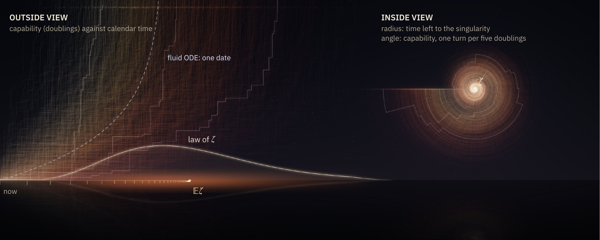
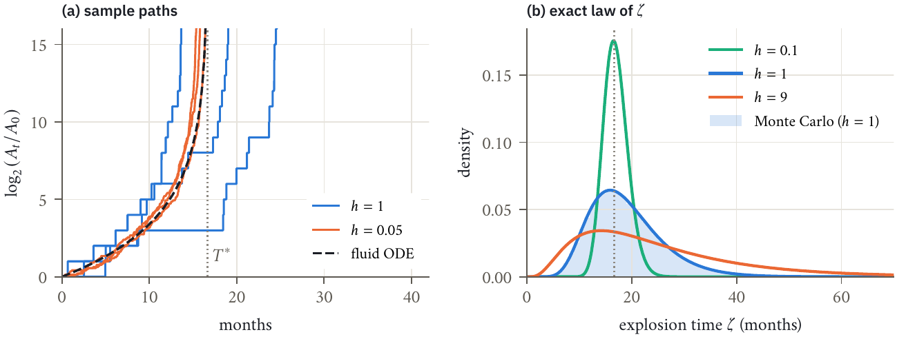
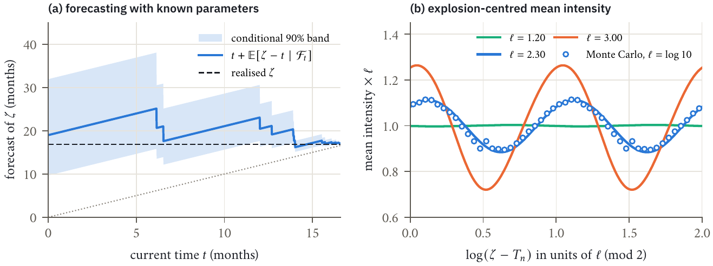
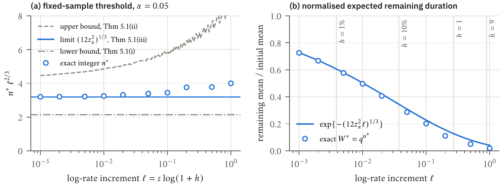
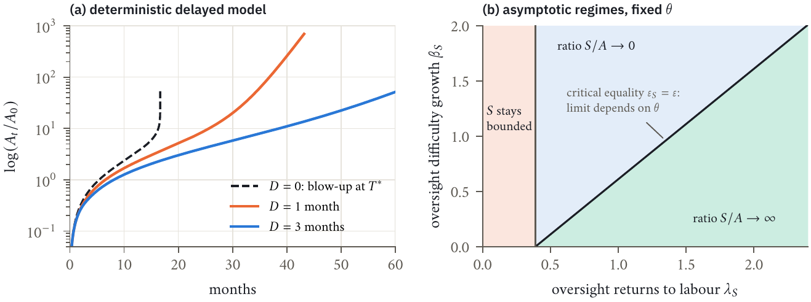

<p align="center">
  
</p>

<h1 align="center">The Singularity Has a Distribution</h1>
<p align="center"><b>Exact timing laws and detection limits for a stochastic intelligence explosion</b></p>

<p align="center">
  Xiaoyu Li<sup>1</sup> · Zheng Gao<sup>1</sup> · Chiwun Yang<sup>2</sup> · Zhizhou Sha<sup>3</sup><br>
  <sub><sup>1</sup>University of New South Wales &nbsp; <sup>2</sup>City University of Hong Kong &nbsp; <sup>3</sup>University of Texas at Austin</sub>
</p>

<p align="center">
  <a href="paper/The_Singularity_Has_a_Distribution.pdf"><b>Paper (PDF)</b></a> &nbsp;·&nbsp;
  <a href="https://xiaoyulics.github.io/singularity-distribution/"><b>Interactive project page</b></a> &nbsp;·&nbsp;
  <a href="#reproduce-every-number"><b>Reproduce</b></a> &nbsp;·&nbsp;
  <a href="#citation"><b>Cite</b></a>
</p>

---

Automating AI research makes capability feed its own growth. The standard feedback law,

$$\dot A = c\,A^{1+\varepsilon},\qquad \varepsilon=\lambda-\beta=\beta(r-1),$$

blows up on **one date** when the returns to research effort exceed $r=1$. Real research does not move smoothly: it arrives as discrete ideas at random times. Keep the drift of the law, let ideas arrive at a rate proportional to $A^{\varepsilon}$ and multiply capability by a factor, and the date of the singularity becomes a **random variable with an exact law**. This repository holds the paper and the code behind every number in it.

## What the paper shows

**1. The threshold does not move; the date does.** For every law of positive, independent idea sizes, the process explodes almost surely if $r>1$ and never if $r\le 1$. Randomness changes *when*, not *whether*.

**2. The date has an exact law, and Euler's identities write it down.** For ideas of equal relative size $h$, the explosion time is a geometrically weighted sum of exponentials, $\zeta=\sum_{n\ge0}e_n/(q_0\rho^{n})$ with $\rho=(1+h)^{\varepsilon}$. Writing $q=1/\rho$ and $\bar\zeta=q_0\zeta$:

$$\mathbb E\,e^{-s\bar\zeta}=\frac{1}{(-s;q)_\infty},\qquad
\frac{\mathbb E\,\bar\zeta^{\,n}}{n!}=\frac{1}{(q;q)_n},\qquad
\mathbb E\,\bar\zeta^{\,s}=\frac{\Gamma(1+s)\,(q^{1+s};q)_\infty}{(q;q)_\infty}.$$

The moments count integer partitions, a slow takeoff carries the partition generating function as its constant, and Lomax-distributed idea sizes give an exactly Gamma-distributed date. Several of these identities are classical (exponential functionals of Poisson processes, AIMD congestion control); the paper gives self-contained proofs and reads them as statements about timing.

**3. Midnight never gets closer in its own units.** With parameters known, at every stopping time the remaining time, measured in the current expected waiting time, has the same law, whatever has happened so far. For doubling-sized ideas the singularity is always expected **4.22 current doubling times** away (90%: 2.15 to 7.10).

**4. Seeing it coming takes $n\propto\ell^{-2/3}$ ideas.** To tell an accelerating process from steady exponential growth in a fixed-sample experiment with known baseline and known log-rate increment $\ell$ per idea, the minimum sample size is

$$n^\ast(\alpha,\ell)\sim\big(12\,z_\alpha^2\big)^{1/3}\,\ell^{-2/3},$$

with matching non-asymptotic bounds and exact finite-sample thresholds.

**5. Near $r=1$ the expected wait is infinite.** If the returns parameter is uncertain with positive density at its critical value, the waiting time has a $1/t$ tail with an exact constant, so its mean is infinite even though explosion is certain once $r>1$.

**6. Delays, diversion and a race with oversight.** In a deterministic delayed-feedback model any deployment delay removes the blow-up and leaves double-exponential growth, $\log\log A(t)\sim t\log r/D$. A diverted share of effort that grows with capability at elasticity $\gamma\ge 1-1/r$ defuses the explosion. In a race between capability and oversight with a fixed allocation share, the asymptotic regime is set by the exponents of oversight research, except on a critical line where the share sets the limit.

## The numbers, at the working paper's calibration

Central values $\lambda=1.40$, $\beta=1.01$ from Chan et al. (2026), and capability initially doubling every 4.5 months. The deterministic law blows up at **16.6 months**; the stochastic model turns that date into a distribution whose width depends on how lumpy progress is. These are illustrations of the theorems, not forecasts.

| idea size $h$ | mean date | 90% of the law | explodes within a year | ideas needed to tell ($\alpha=5\%$) | time left at that point |
|---|---:|---:|---:|---:|---:|
| 0.01 | 16.7 months | 15.5 – 17.9 | $1.2\times10^{-13}$ | 130 | 10.1 months |
| 0.1 | 17.0 months | 13.4 – 21.0 | 0.7% | 30 | 5.6 months |
| 1 (each idea doubles) | 19.0 months | 9.7 – 31.9 | 14.0% | 9 | 1.7 months |
| 9 | 25.2 months | 6.9 – 57.0 | 19.6% | 5 | 0.3 months |

## Figures

| | |
|:--:|:--:|
|  |  |
| Sample paths and the exact law of $\zeta$ | Forecasting from inside the explosion |
|  |  |
| The cube-root law of detection | Delays and the oversight race |

The [project page](https://xiaoyulics.github.io/singularity-distribution/) makes these interactive: roll your own histories and watch them fill the exact law, or move the idea size and read off the detection threshold.

## Reproduce every number

No number in the paper is typed by hand: `code/make_numbers.py` writes them all as LaTeX macros, which the manuscript reads.

```sh
git clone https://github.com/xiaoyulics/singularity-distribution
cd singularity-distribution
pip install -r requirements.txt
sh reproduce.sh          # Windows PowerShell: ./reproduce.ps1
```

| Path | What it does |
|---|---|
| `code/timing.py` | Exact numerics: the $q$-series law with automatic working precision and certified truncation, quantiles, exact fixed-sample detection errors, the delay equation |
| `code/make_numbers.py` | Every quantity in the paper → `generated/numbers.tex`, `generated/numbers.json` |
| `code/run_checks.py` | 52 checks → `generated/checks_report.txt`: regression targets, precision doubling, structure, Monte Carlo with standard errors, exact detection boundary pairs, delay-equation grid refinement |
| `code/check_small_time.py` | The small-time tail at up to 18,000 digits |
| `code/make_figures.py`, `code/make_hero.py` | All figures, with text set by LaTeX in the paper's fonts |
| `code/make_web_data.py` | The exact curves behind the project page (`docs/`) |
| `paper/` | The paper (PDF) |

Requires Python 3 with numpy, scipy, mpmath, matplotlib and pillow; the figure scripts also need a LaTeX installation with the `cochineal`, `newtx` and `plex` packages. Seeds are fixed.

## Scope

The model is deliberately minimal: independent, positive improvements, exponential waiting times and a constant growth exponent, with compute and data frictions left out. The detection theorem concerns a fixed-sample binary experiment, not an anytime alarm. The calibrated numbers depend on an explicit convention for what "doubling time" means (Box 1 of the paper) and are not forecasts of AI development.

## Citation

```bibtex
@misc{li2026singularity,
  title  = {The Singularity Has a Distribution: Exact Timing Laws and
            Detection Limits for a Stochastic Intelligence Explosion},
  author = {Li, Xiaoyu and Gao, Zheng and Yang, Chiwun and Sha, Zhizhou},
  year   = {2026},
  note   = {Working paper},
  url    = {https://github.com/xiaoyulics/singularity-distribution}
}
```

Correspondence: [xiaoyulics@gmail.com](mailto:xiaoyulics@gmail.com)
